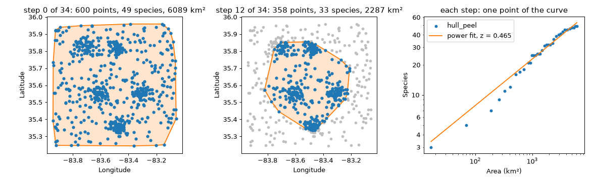
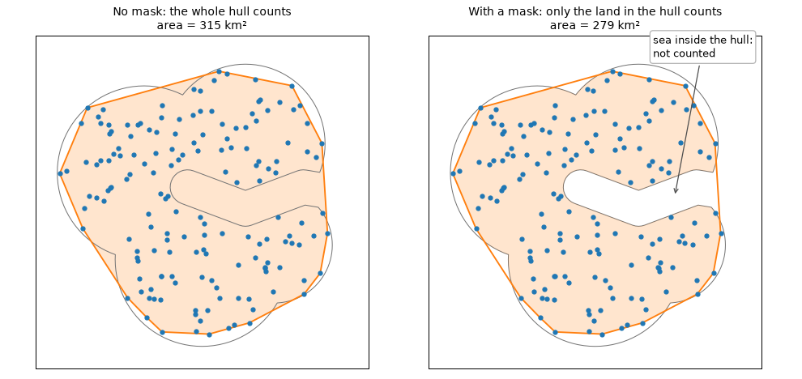

# samplesar

Species-area relationships from georeferenced species records.

A species-area relationship (SAR) needs areas and the number of species in
each. samplesar builds that table from point observations (iNaturalist,
GBIF, a survey) in two ways, and hands it to
[sars](https://jmcmeen.github.io/sars/) for curve fitting:

- **Nests:** shrink one sample step by step with a sampling strategy, and
  record the area and species of what remains at each step.
- **Regions:** count the species in each of several regions you choose
  (states, parks, real islands), one row per region.

```python
import samplesar

sample = samplesar.sources.simulated(seed=1)     # or sources.csv("observations.csv")
nest = samplesar.strategies.hull_peel(sample)    # shrink it from the outside in
nest.to_frame()                                  # step, n_points, area (km²), species
fit = nest.fit("power")                          # sars' power model: S = c·A^z
```



Documentation: <https://jmcmeen.github.io/samplesar/>

## Install

```sh
pip install samplesar
```

Plots need matplotlib (`pip install matplotlib`). Optional extras add data
sources:

| Extra | For |
| --- | --- |
| `samplesar[inat]` | `sources.inaturalist`: observations fetched from iNaturalist's API |
| `samplesar[opendata]` | `sources.open_data`: iNaturalist's open-data export, read from a local copy |
| `samplesar[gbif]` | `sources.gbif`: occurrences from GBIF |
| `samplesar[geo]` | `regions.read`, `regions.read_units` and `regions.ecoregion`: regions from boundary files |

## Try it

No data needed: `sources.simulated` makes up a landscape of observations
(a ridge, species with home ranges, visits piled around a few places, with
elevations and dates) that everything below runs on.

- [Example scripts](examples/): six short scripts, each from observations
  to a table and a figure. `python examples/01_first_nest.py`
- Notebooks in the documentation:
  [a first nest](https://jmcmeen.github.io/samplesar/examples/first_nest/),
  [comparing strategies](https://jmcmeen.github.io/samplesar/examples/strategies/) and
  [regions as islands](https://jmcmeen.github.io/samplesar/examples/islands/).

## Terms

- **Sample:** a set of species observations, each at a longitude and
  latitude, optionally with an elevation and a date.
- **Strategy:** a sampling design: the rule that picks which points make up
  each subset of the sample.
- **Nest:** what a strategy returns: a sequence of subsets, each inside the
  one before.
- **Area:** each subset's area in km², measured on an equal-area projection
  centered on the sample (and, with a mask, only within it).

## Getting observations in

| From | With |
| --- | --- |
| A table you have | `sources.dataframe`, `sources.csv`, `sources.geodataframe` |
| iNaturalist | `sources.inaturalist` (its API), `sources.open_data` (its open-data export) |
| GBIF | `sources.gbif` |
| Nothing yet | `sources.simulated` |

Then, before nesting:

- `Sample.within(region)` keeps the observations inside a region.
  `samplesar.regions` gives regions: countries, states and counties from
  geoBoundaries (`admin`), US EPA and RESOLVE ecoregions (`ecoregion`), or
  any boundary file or URL (`read`).
- `Sample.merge_within(meters)` merges records made at one spot (a
  trailhead, a feeder) that differ only by GPS jitter. Left apart, they make
  the last steps of a hull nest measure hulls centimeters across.
- `Sample.thin(km)` keeps one point per grid cell, so a pile of records in
  one place counts once.
- Elevations and dates come along when a source has them (GBIF,
  iNaturalist) or you name the columns (`elevation_col`, `date_col`).

## Strategies

Each strategy is one function in `samplesar.strategies`, also callable by
name through `strategies.run(sample, "hull_peel")`.

| How it shrinks the sample | Strategies |
| --- | --- |
| **At random** (baselines) | `random`: any point. `hull_random`: a hull vertex. `hull_weighted`: a hull vertex, favoring isolated ones. `from_order`: an order you give |
| **A layer at a time** | `hull_peel`: the whole convex hull. `concave_peel`: a concave hull that follows the outline. `grid_peel`: the hull of occupied grid cells |
| **The hull vertex that...** | `hull_area`: changes the area least or most (`hull_masked_area`: within a mask). `hull_species`: loses the fewest or most species. `hull_rarity`: holds the most common, or the rarest, species. `hull_distance`: is farthest from or nearest to the center. `circle`: shrinks the smallest enclosing circle most |
| **By position**, ranked once | `radial`: farthest from a center first (discs or ellipses). `sweep`: a front moving across. `band`: closing in on a line from both sides. `sector`: one compass sector after another. `density_peel`: sparsest first. `grow`: outward from a seed, reversed |
| **By elevation or date** | `elevation`: from the summits down, the valleys up, or toward a band. `temporal`: back through time |
| **As several patches** | `split`: divide the sample into parts (clusters, a grid, your polygons) and run any strategy inside each; areas are the parts' hulls together |

[Sampling strategies](https://jmcmeen.github.io/samplesar/strategies/)
describes each one.

## Areas within a mask

A convex hull can reach over ground that isn't habitat: the sea along a
coast, an inlet, a lake, the bay of a concave island. Left alone, that
ground counts as area sampled, most at the large end of the curve.

With a **mask**, every area is the part of the hull inside a region you give
(land, say). The hull itself, and which points each strategy removes, stay
the same. In plots, the orange outline is the hull and **only the shaded
part counts toward the area**:



```python
costa_rica = samplesar.regions.admin("CRI")
frogs = samplesar.sources.open_data(parquet, boundary=costa_rica, taxon_id=20979)

land = frogs.with_mask(costa_rica)     # or frogs.within(costa_rica, mask=True)
nest = samplesar.strategies.hull_peel(land)
nest.to_frame()                        # area: the land in each hull; hull_area: the whole hull
```

For iNaturalist's frog records across Costa Rica, a quarter of the full hull
is sea. Measured on land only, the fitted z of hull peeling rises from 0.18
to 0.20.

## Regions as sampling units

A nest shrinks one sample, so its areas are arbitrary. To use regions you
choose (states, parks, real islands) as the units instead, one row each:

```python
states = samplesar.regions.admin_units("USA", level=1)   # name -> polygon
islands = samplesar.designs.islands(sample, states)
islands.to_frame()     # region, area (km²), species, n_points, n_observations
islands.fit("power")
```

This is species-area data of the island type. It is a different design
from a nest, and the two kinds of curve aren't comparable point for point:
see [Regions as sampling units](https://jmcmeen.github.io/samplesar/islands/).

## Evaluating and plotting

Steps of one nest share most of their points, so a single nest's R² isn't
independent evidence. `samplesar.evaluate` judges nests against each other
and against chance:

- `compare` fits several nests side by side.
- `baseline` and `against_baseline` place a strategy's fit among many
  random nests of the same sample.
- `ensemble` averages many random nests into one curve with a band;
  `bootstrap` refits a strategy on resamples of the points.
- `diagnostics` and `autocorrelation` describe how a nest shrinks and how
  far its steps are from independent.

`samplesar.plot` draws one step of a nest (`nest`), the species-area curve
with its power fit (`curve`), and the whole nest as an animation
(`animate`).

## Development

```sh
make install   # create .venv with dev tooling
make check     # lint, format check, type check, tests
make docs      # build the documentation site
```
