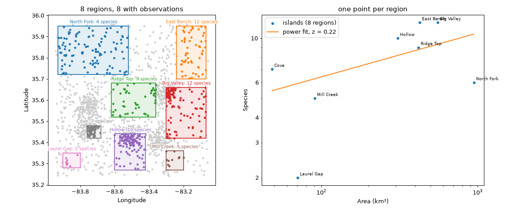

# Regions as sampling units

The [sampling strategies](strategies.md) take one sample and shrink it, so
the areas they measure are arbitrary: hulls of whichever points remain.
`samplesar.designs.islands` does the other thing. You give it regions
(states, counties, parks, ecoregions, real islands) and it counts the
species observed in each, one row per region. That is species-area data of
the island type, from the same observations.

```python
import samplesar

states = samplesar.regions.admin_units("USA", level=1)      # name -> polygon
islands = samplesar.designs.islands(sample, states)

islands.to_frame()     # region, area (km²), species, n_points, n_observations
islands.fit("power")   # sars fits the regions' areas and species counts
```



`plot.islands(islands)` draws the map: every region with its points and the
species observed in it, and in gray the points that fall in no region and
so aren't counted. `plot.curve(islands)` draws the curve, one point per
region.

The two designs answer different questions and their curves aren't
comparable point for point. A nest's steps share most of their points, so
they are far from independent; regions are separate units, as islands are.
A nest's areas come from the observations; a region's area is its own.

## Where regions come from

`islands` takes a mapping of name to polygon, a sequence of polygons (with
`names`), or a GeoSeries or GeoDataFrame in any CRS (named by its index, or
by the column you give as `names`).

- `regions.admin_units(country, level)`: every state, county or district of
  a country from geoBoundaries, each as its own polygon, or only those in
  `names=["Alabama", "Georgia", "Texas"]`. With
  `inside=samplesar.regions.admin("USA", 1, "Tennessee")` and `level=2` it
  gives Tennessee's counties.
- `regions.read_units(source, column)`: the regions of any boundary file or
  URL, one per value of `column`: national parks from a protected-areas
  layer, ecoregions, watersheds.

## Building a design by hand

A design doesn't have to be "every unit of something". Regions are a plain
mapping of name to polygon, so you choose which ones go in and where each
comes from:

```python
tennessee = samplesar.regions.admin("USA", 1, "Tennessee")

# A few counties, by name.
counties = samplesar.regions.admin_units(
    "USA", 2, names=["Sevier", "Blount", "Cocke"], inside=tennessee
)
# A handful of parks from a boundary file.
parks = samplesar.regions.read_units(
    "parks.gpkg", "UNIT_NAME", ["Great Smoky Mountains", "Shenandoah"]
)
# An area you drew yourself.
mine = {"Study plot": shapely.box(-83.6, 35.5, -83.4, 35.7)}

islands = samplesar.designs.islands(
    sample,
    {**counties, **parks, **mine},              # several sources, one design
    areas={"Shenandoah": 806},                  # use the park's official km², not the outline's
    units={"Mammoth Cave": (214, 12)},          # a row typed in: km² and species, nothing else
)
```

- **`areas`** replaces a region's measured area with one you know. Its
  species are still counted from the observations inside it.
- **`units`** adds rows you give outright, from a paper or a checklist: a
  name with its area and species count, as `(km², species)`, as
  `{"area": ..., "species": ...}`, or as a DataFrame with `region`, `area`
  and `species`. They need no boundary and no observations, and a design
  can be made of them alone: `designs.islands(units={...})`.
- **`add`, `select` and `drop`** go on from a design:
  `islands.add(more_parks)`, `islands.add(units={"Cumberland Gap": (97, 9)})`,
  `islands.drop(["Cocke"])`, `islands.select(["Sevier", "Blount"])`.

The table's `source` column says where each row's numbers come from:
`measured`, `area given` or `given`. Rows given by hand have no
observation counts, are always kept in fits, and aren't on the map
(`plot.islands` says how many).

## What a region's area is

- `area="region"` (the default): the region's own area on the WGS84
  ellipsoid, as island studies use. With `mask=` (land, say) it is the part
  of each region within the mask.
- `area="hull"`: the area of the convex hull of the region's points that
  lies within it: the ground the observations span. `region_area` then
  gives the whole region's area beside it.

## Sampling effort

Regions with more observers have more species recorded, whatever their
area. The table gives each region's observations and points so that effort
can be checked, or used as a covariate. `sar_data` and `fit` leave out
regions without any observations (`min_observations=1`), since in
observation data an empty region is more often unvisited than without
species; `min_observations=0` keeps them, and a larger value drops thinly
sampled regions.

## Nesting within a region

`islands.sample_of("Tennessee")` is that region's observations as a
`Sample` whose areas are measured within the region, ready for any
strategy. The same regions can also split one nest into patches:
`strategies.split(sample, "hull_peel", by=list(states.values()))`.
